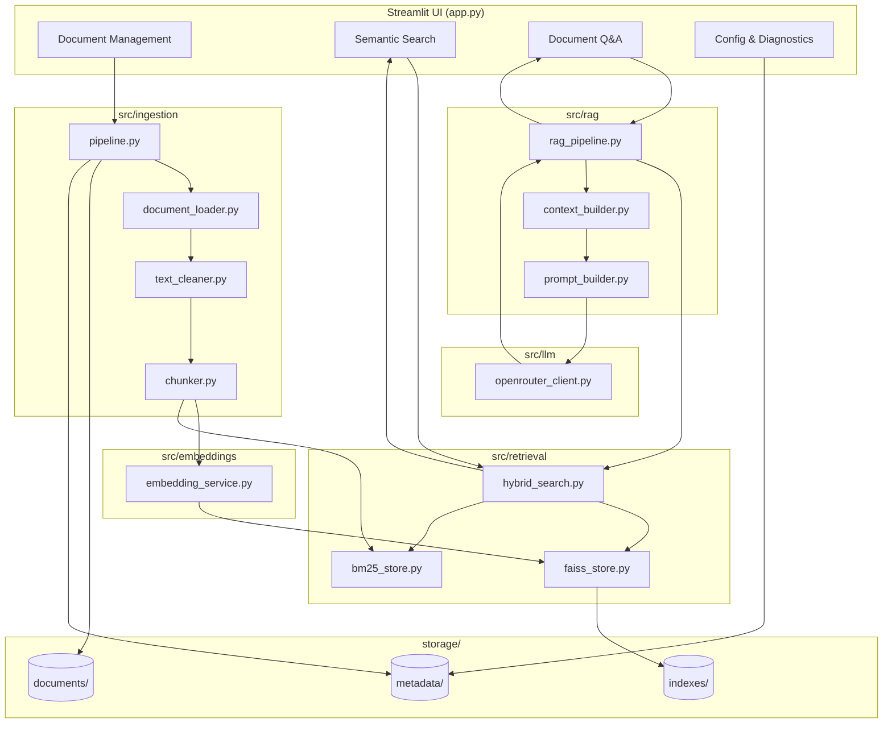

# Semantic Search + RAG Document Q&A

A local Semantic Search and Retrieval-Augmented Generation (RAG) application.
Upload PDF/DOCX/TXT/Markdown documents, search their contents semantically,
by keyword, or both combined, and ask questions answered from the documents
themselves with source citations.

**Status:** all 10 phases complete.

Everything runs locally and free except one thing: the Q&A tab's final
answer-generation step, which calls an open-weight LLM hosted via Hugging
Face Inference Providers and needs your own (free-tier-limited) API token.
Document upload, chunking, embeddings, FAISS, and BM25 need no account at all.

---

## 1. Architecture



### Data flow

**Ingestion** (upload → searchable): `document_loader` extracts text (+ page
numbers for PDF) → `text_cleaner` normalizes whitespace without destroying
structure → `chunker` splits into overlapping, stably-ID'd chunks →
`embedding_service` embeds only the *new* chunks → `faiss_store.add()`
appends them (no re-embedding of anything already indexed) → `bm25_store`
rebuilds from all persisted chunk text (cheap — no embeddings involved).

**Query** (question → answer): query is embedded for FAISS and tokenized for
BM25 → both return ranked candidates independently → `hybrid_search` fuses
them with Reciprocal Rank Fusion → (Q&A only) `context_builder` dedupes and
char-budgets the top chunks → `prompt_builder` builds a system+user prompt
that treats retrieved text as untrusted, cited evidence → `openrouter_client`
calls the LLM → answer + sources returned to the UI.

### Why each piece exists

| Component | Role | Key trade-off |
|---|---|---|
| **Embeddings** (`BAAI/bge-small-en-v1.5`, 384-dim, local) | Turn text into vectors where meaning ≈ geometric closeness | Local/CPU-friendly vs. larger models' better accuracy |
| **FAISS** (`IndexFlatIP`) | Exact nearest-neighbor search over normalized vectors (= cosine similarity) | Exact & simple vs. ANN (IVF/HNSW) which trades a little accuracy for speed at much larger scale |
| **BM25** (`rank-bm25`) | Exact-token keyword matching — catches IDs/codes/names embeddings can blur | Blind to paraphrase, but precise on exact strings |
| **RRF** | Fuses FAISS + BM25 by *rank position*, not raw score, since the two scores live on incompatible scales | Simple and scale-free vs. a learned re-ranker, which would need training data this project doesn't have |
| **OpenRouter** | Hosted, open-weight instruction-tuned LLM via an OpenAI-compatible chat completions API | Only non-local, non-free-at-scale piece; free (`:free`-suffixed) models exist but churn often and get rate-limited hard at peak times |

### Project structure

```text
semantic-rag-project/
├── app.py                      Streamlit UI (thin: no business logic)
├── requirements.txt
├── pytest.ini
├── .env.example
├── config/settings.py          All configuration, env-driven
├── src/
│   ├── ingestion/               document_loader, text_cleaner, chunker, pipeline
│   ├── embeddings/               embedding_service
│   ├── retrieval/                 faiss_store, bm25_store, hybrid_search
│   ├── rag/                       context_builder, prompt_builder, rag_pipeline
│   ├── llm/                       base (Protocol), openrouter_client
│   └── utils/                     metadata, indexing (orchestration glue), timing
├── storage/
│   ├── documents/                original uploaded files, one dir per doc_id
│   ├── indexes/                  faiss_index.bin, faiss_id_map.json
│   └── metadata/                 documents.json, chunks_<doc_id>.json
├── sample_docs/                  demo documents (see Section 4)
├── scripts/                      generate_sample_docs.py, verify_demo.py
└── tests/                        17 test files, 109 tests
```

---

## 2. Setup (Windows PowerShell)

```powershell
python -m venv venv
.\venv\Scripts\Activate.ps1
python -m pip install --upgrade pip
pip install -r requirements.txt
Copy-Item .env.example .env
```

First run of the embedding service downloads `BAAI/bge-small-en-v1.5` (~130MB)
from the Hugging Face Hub and caches it under `~/.cache/huggingface/hub` —
needs internet once, then works fully offline for embeddings/FAISS/BM25. No
Hugging Face account or token is needed for this; the model is public.

To use the Document Q&A tab against a real LLM:
1. Get a key at https://openrouter.ai/keys and set `OPENROUTER_API_KEY` in
   `.env`.
2. Check https://openrouter.ai/models?max_price=0 for the current free-model
   list — `:free` model slugs churn often as providers add/remove
   prerelease checkpoints (the default below was confirmed working at the
   time this was written, but verify it's still live). Change
   `OPENROUTER_MODEL` in `.env` if it isn't.
3. Free models get rate-limited hard at peak times (a 429 response) — if
   that happens, wait and retry or switch to a different free model.
4. See [Section 5](#5-cost-considerations).

## 3. Running

```powershell
streamlit run app.py
```

Opens at http://localhost:8501 with four tabs: **Document Management**,
**Semantic Search**, **Document Q&A**, **Configuration & Diagnostics**.

```powershell
pytest -v
```

Runs all 111 automated tests (~25-35s; downloads/loads the real embedding
model, no network calls for anything else — the OpenRouter LLM boundary is
tested with error-mapping stubs, never a real paid request).

---

## 4. Demo

Four sample documents are checked into `sample_docs/`, each in a different
supported format, generated by `python scripts/generate_sample_docs.py`
(already run — the files are committed):

| File | Format | Purpose |
|---|---|---|
| `refund_policy.md` | Markdown | General semantic search / multi-section Q&A |
| `product_catalog.txt` | TXT | Exact identifier (`ACME-4471-X`) — showcases BM25 |
| `employee_handbook.pdf` | PDF, 2 pages | Page-number citation (vacation policy is on page 2) |
| `onboarding_notes.docx` | DOCX | A fourth format, different topic, for corpus diversity |

### Try it

1. `streamlit run app.py` → **Document Management** → upload all four files
   from `sample_docs/`.
2. **Semantic Search** tab, mode "Compare all three", try:
   - `"ACME-4471-X"` — BM25 should rank `product_catalog.txt` highly by
     exact match; semantic alone may rank it lower.
   - `"time off for new hires"` — semantic should find
     `employee_handbook.pdf` page 2 even though it shares no exact words
     with the query.
3. **Document Q&A** tab (needs `OPENROUTER_API_KEY` set), ask:
   - *"How long do refunds take to process?"* → should cite
     `refund_policy.md`.
   - *"What is part number ACME-4471-X?"* → should cite
     `product_catalog.txt`.
   - *"How many vacation days do new employees get?"* → should cite
     `employee_handbook.pdf, page 2`. **Confirmed working** — a real run
     against the live OpenRouter API returned: *"New employees accrue 15
     paid vacation days per year (credited monthly from their hire date)
     [Source 1: employee_handbook.pdf, page 2]."*
   - Follow-up: *"What about exchanges?"* → tests conversation-history
     contextualization (retrieval should still find the refund policy's
     exchange section without you repeating "refund policy").
   - *"What is the company's policy on space travel?"* → none of the
     sample docs mention this. **Read this carefully**: retrieval will
     still return *something* (FAISS's exact search always returns its
     nearest neighbors, however weak the real match is — it never returns
     "nothing" for a non-empty corpus). The correct behavior here comes
     from the LLM itself: the system prompt's rule #4 tells it to say
     plainly that the context doesn't answer the question, rather than
     from a retrieval-layer short-circuit. This is a deliberate two-layer
     design — see [Section 6](#6-known-limitations).

`scripts/verify_demo.py` re-runs the retrieval side of these questions
against a throwaway copy of `storage/` and prints what each one actually
retrieves, without touching your real uploaded documents or needing an LLM
token:

```powershell
$env:PYTHONPATH="."
python scripts\verify_demo.py
```

---

## 5. Cost Considerations

- **Local pipeline (ingestion, embeddings, FAISS, BM25): $0, no account.**
  Everything runs on your CPU.
- **LLM calls (Document Q&A only)**: go through OpenRouter. Any
  **`:free`-suffixed model costs $0 per token**, but the free tier is
  rate-limited hard at peak times (429 responses — the client surfaces
  this with a clear message rather than retrying silently) and free model
  availability churns: one default I tried while building this
  (`qwen/qwen-2.5-7b-instruct:free`) had already been pulled by the time I
  tested it live, and a second (`google/gemma-4-26b-a4b-it:free`) got
  rate-limited on a second call seconds later. Check
  https://openrouter.ai/models?max_price=0 for the current list before
  relying on any specific model, and keep a second free model in mind to
  switch to if one starts failing. Paid OpenRouter models (no `:free`
  suffix) bill per token at whatever that model's page states.
- **No cost surprises by design**: `RagPipeline` never calls the LLM when
  retrieval finds nothing (empty corpus) — you only pay when there's
  actually something to answer from.

## 6. Known Limitations

- **Retrieval always returns its nearest neighbors, even for off-topic
  queries.** `FAISS.IndexFlatIP.search()` is exact nearest-neighbor search,
  not a relevance filter — it returns the top-K closest vectors no matter
  how weak the actual similarity is. "No relevant evidence found" is
  therefore handled at two different layers: `RagPipeline` short-circuits
  only when retrieval is *completely* empty (e.g. no documents uploaded
  yet), while a genuinely off-topic question against a non-empty corpus
  relies on the LLM itself recognizing weak context and saying so (system
  prompt rule #4). A future improvement would add a minimum-similarity
  threshold before fusion — deliberately not done here, since a good
  threshold is corpus- and embedding-model-dependent and picking one
  without real usage data to calibrate against would just be a different
  kind of guess.
- **BM25 has no stopword removal.** A query sharing only common words
  ("the", "of", "a") with a chunk can register as a weak match. Simple by
  design; see `src/retrieval/bm25_store.py`.
- **Follow-up question contextualization is a heuristic, not a rewrite.**
  `RagPipeline` prepends the previous question to the current one for
  retrieval purposes; it doesn't call an LLM to rewrite the query. Works
  for simple follow-ups ("what about X?"), not for complex multi-turn
  reference chains.
- **Deletion rebuilds the whole FAISS index.** Cheap at this project's
  scale (vectors are reconstructed from the index itself, never
  re-embedded — see `FaissStore.get_vectors`), but would need a different
  approach (e.g. an `IndexIDMap` with true `remove_ids`) at a much larger
  document count.
- **No OCR.** Scanned/image-only PDFs raise `EmptyDocumentError` rather
  than silently returning nothing — intentional (explicit over silent),
  but you cannot currently extract text from them.
- **Single-user, no auth.** This is a local tool, not a multi-tenant
  service.
- **Chunking is character-based, not token-based.** No extra tokenizer
  dependency, but the char↔token ratio is an approximation; `MAX_CONTEXT_CHARS`
  has headroom built in, but very dense technical text could still use more
  tokens-per-character than assumed.

## 7. Future Improvements

- Minimum-similarity thresholding before RRF fusion, calibrated against
  real usage.
- OCR fallback for scanned PDFs.
- An ANN FAISS index (IVF or HNSW) if the corpus grows past the
  comfortable range for exact search.
- Streaming LLM responses in the UI instead of waiting for the full answer.
- A real query-rewriting step (small LLM call) for follow-up questions
  with more complex references than "what about X?".

---

## Appendix: all test files

```powershell
pytest -v
```

| File | Covers |
|---|---|
| `test_chunker.py`, `test_text_cleaner.py`, `test_document_loader.py`, `test_ingestion_pipeline.py` | Phase 2: ingestion |
| `test_embeddings.py` | Phase 3: embeddings |
| `test_retrieval.py` | Phase 4: FAISS |
| `test_bm25.py` | Phase 5: BM25 |
| `test_hybrid_search.py` | Phase 6: RRF fusion |
| `test_context_builder.py`, `test_prompt_builder.py`, `test_openrouter_client.py`, `test_rag_pipeline.py` | Phase 7: RAG + LLM |
| `test_indexing.py`, `test_app_smoke.py` | Phase 8: UI orchestration + headless smoke test |
| `test_timing.py`, `test_restart_persistence.py` | Phase 9: latency + restart/deletion persistence |
